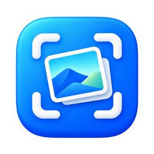

# OpenLightCapture



A native macOS menu bar screenshot tool. Select an area, annotate it, capture scrolling content, and copy the result as an image or paste it into Finder as a PNG file.

[简体中文](README.md) · **English**

Follow the author [@EverSeenU on X](https://x.com/EverSeenU) for project updates and development notes, and share your experience with the app.

[User guide](docs/USER_GUIDE.md) · [Development](docs/DEVELOPMENT.md) · [Contributing](CONTRIBUTING.md) · [Privacy](PRIVACY.md) · [Changelog](CHANGELOG.md)

## Features

| Feature | What it does |
|---|---|
| Area and window capture | Default shortcut `⇧⌘A`; press `Space` to switch selection modes |
| Inline annotations | Rectangle, ellipse, arrow, brush, text, mosaic; select and drag any annotation, style controls, undo and redo |
| Scrolling screenshots | Manual and automatic scrolling, pause/resume, and explicit partial results |
| Image and file paste | One clipboard item provides PNG data and a file URL for image apps and Finder |
| Save as PNG | Choose a destination and retain the copy workflow |
| Two interface languages | Follow System, Simplified Chinese, or English, with a persistent preference |
| Native operation | Menu bar access, configurable shortcut, optional Launch at Login; no account or cloud processing |

Images are processed locally. The current app has no network requests, telemetry, or third-party runtime dependencies. Selection previews temporarily read display images, and Finder paste uses a locally stored PNG. See [Privacy](PRIVACY.md) for the actual data flow and retention behavior.

## Status and compatibility

The current version is **1.0.0 (build 27)**.

- Targets macOS 14 or later.
- Builds for Apple Silicon (`arm64`) and Intel (`x86_64`). Intel hardware and older macOS versions have incomplete hands-on coverage.
- Validation on macOS 27.0.1, Apple Silicon, and Xcode 27.1 passed 199 XCTest tests, arm64/x86_64 builds, signature checks, and bilingual resource checks. Hands-on permission and GUI checks for the new app identity remain pending.
- Local builds use ad hoc signing and have not been Developer ID signed or notarized by Apple.

See [Known limitations](docs/USER_GUIDE.md#limits) and the [development checks](docs/DEVELOPMENT.md) for scope and evidence.

## Get the app

Download the [OpenLightCapture 1.0.0 universal DMG](https://github.com/evilstar2016/OpenLightCapture/releases/download/v1.0.0/OpenLightCapture-1.0.0-macOS-universal.dmg), open it, and drag `OpenLightCapture.app` to `Applications`. Both Apple Silicon and Intel are supported.

[Release notes](https://github.com/evilstar2016/OpenLightCapture/releases/tag/v1.0.0) · [SHA-256 checksum](https://github.com/evilstar2016/OpenLightCapture/releases/download/v1.0.0/OpenLightCapture-1.0.0-macOS-universal.dmg.sha256). The bundled app uses ad hoc signing without Developer ID signing or Apple notarization; macOS may block its first launch. You can also build from source using the commands below.

Local builds use ad hoc signing and have not been Developer ID signed or notarized by Apple. The local `build/` directory is not committed.

You need full Xcode, a Swift 6 toolchain, and [XcodeGen](https://github.com/yonaskolb/XcodeGen):

```sh
git clone https://github.com/evilstar2016/OpenLightCapture.git
cd OpenLightCapture
xcodegen generate
xcodebuild -project OpenLightCapture.xcodeproj \
  -scheme OpenLightCapture \
  -configuration Release \
  -destination 'generic/platform=macOS' \
  -derivedDataPath build/DerivedData \
  ARCHS='arm64 x86_64' ONLY_ACTIVE_ARCH=NO \
  build
ditto build/DerivedData/Build/Products/Release/OpenLightCapture.app build/OpenLightCapture.app
```

Open `build/OpenLightCapture.app`, or run the project in Xcode. See the [development guide](docs/DEVELOPMENT.md) for prerequisites and verification.

## First capture

1. Open the app and choose **Capture** from the menu bar, or press `⇧⌘A`. The app normally has no Dock icon.
2. Allow Screen Recording when prompted, then quit and reopen the app.
3. Drag to select an area. Press `Space` for window selection. Use the selection toolbar to annotate.
4. Choose **Finish and Copy**, or use `Enter` / `⌘C`; paste with `⌘V` in an image app or Finder.
5. Use the save action or `⌘S` to save a PNG. For scrolling captures, end acquisition first, then finish in the editor to publish the result.

The default shortcut may conflict with Feishu. Change it in either app if needed. Capture starts only after a user action.

## Languages and permissions

**Settings → Language** offers Follow System, Simplified Chinese, and English. Unsupported system languages fall back to English. Changes apply immediately while idle, or after the active capture/editing session finishes or is cancelled. System dialogs may retain the system language.

| Permission | Used for |
|---|---|
| Screen Recording | Regular, manual scrolling, and automatic scrolling screenshots |
| Accessibility / control permission | User-initiated automatic scrolling only; the system label varies by macOS version |

The app does not request microphone, camera, or Full Disk Access. See the [user guide](docs/USER_GUIDE.md) for troubleshooting and removal.

## Scrolling limitations

Scrolling captures are limited to 50,000 pixels in height, 60 million pixels in total, and 180 seconds of active acquisition. Repeated content, fixed bars, animation, horizontal drift, or fast scrolling can prevent reliable stitching. Uncertain results pause or are identified as partial.

Screen recording, OCR, cloud sync, screenshot history, and horizontal scrolling captures are outside the current feature set.

## Contribute and get help

- [Issues](https://github.com/evilstar2016/OpenLightCapture/issues): bugs, suggestions, and usage questions; Chinese and English are welcome.
- [Contributing](CONTRIBUTING.md): changes, tests, translations, and pull requests.
- [Support](SUPPORT.md): troubleshooting and report details.
- [Security policy](SECURITY.md): report vulnerabilities privately, without public exploit details or sensitive screenshots.
- [Code of conduct](CODE_OF_CONDUCT.md): community expectations.

Licensed under the [MIT License](LICENSE). Apple frameworks and development tools retain their own terms; see [third-party notices](THIRD_PARTY_NOTICES.md).
