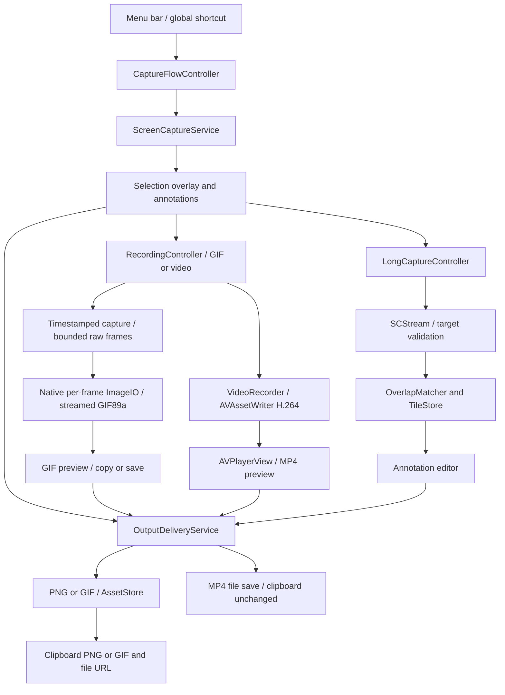

# 架构概览 / Architecture

应用为一个本地 macOS 进程：AppKit 承载菜单、浮层和编辑器，SwiftUI 承载设置与权限帮助。当前没有后端、数据库、任务队列或第三方运行时。

| 目录 / Directory | 职责 / Responsibility |
|---|---|
| [App](../LightCapture/App) | 生命周期、单实例、菜单、Carbon 热键、设置与权限帮助 |
| [Session](../LightCapture/Session) | 单会话、ID/generation、焦点、普通/长图/录制流程 |
| [Capture](../LightCapture/Capture) | ScreenCaptureKit、显示器坐标、自动滚动目标、控制面板、权限检查 |
| [Overlay](../LightCapture/Overlay) | 框选、窗口选择、选区内标注和工具栏定位 |
| [Annotation](../LightCapture/Annotation) | 标注模型、历史命令、画布、共享工具样式、PNG 渲染前的图像合成 |
| [Watermark](../LightCapture/Watermark) | 本地文字模板、默认选择、会话副本、共享 CoreText 布局与绘制、管理器和本次调整弹层 |
| [Stitching](../LightCapture/Stitching) | 像素对齐、唯一性/可靠性检查、增量图块与上限 |
| [Recording](../LightCapture/Recording) | 录制参数；GIF 时间轴、原始素材和流式封装；MP4 实时编码与校验 |
| [Output](../LightCapture/Output) | PNG/GIF 资产与剪贴板、GIF/视频预览、默认命名与文件另存 |
| [Localization](../LightCapture/Localization) | 语言清单、偏好、生效协调、线程安全上下文和文案入口 |

## 需要保持的边界

UI 与会话状态由 MainActor 管理。异步工作回到 UI 前核对会话 ID 与 generation，旧回调不得发布或覆盖新的会话。结束采集与发布截图分开：长图结束后仍需在编辑器完成。

普通截图先在内存中冻结显示器画面，再按选区/窗口选择裁剪。长图按区域接收画面并写入工作图块；帧交付有界，不为每帧无界排队。拼接不可靠时保留已确认内容，暂停或转入部分结果。

`RecordingController` 共享 GIF/视频的选区、准备、倒计时、停止、中断与 attempt 隔离。完整/idle 事件保留实际时间。GIF 有界原始素材存于 WorkingGIF，每帧用 ImageIO 处理色表与 LZW，再流式组装 GIF89a 容器，避免整片原生编码的高内存。预览解码最终文件，未生成成功时明确标注原始预览；异步解码退出后才能删除源素材。

视频由 `VideoRecorder` actor 持有 AVAssetWriter，持续写入无声 H.264/MP4 到 WorkingVideo。保留一帧等待下一时间戳，用显式样本时长补齐静止和尾段；编码背压有超时，取消后等待资源释放再结束会话。成功后用 AVFoundation 核对尺寸、时长、H.264 视频轨和无音轨，释放编码器并用 AVPlayerView 预览。文件另存采用同目录临时复制再替换，不加载全片 Data，不发布剪贴板或纳入图片资产。

只有用户明确输出时才保存或发布剪贴板。图片输出项目同时提供 PNG 或 GIF 数据、文件 URL 与私有资产 ID。`AssetStore` 管理图片文件生命周期；不把用户另存目录纳入回收。

水印模板库在新会话启动时冻结，文档持有独立水印值副本并纳入撤销/重做。画布预览与最终合成共享像素布局和文字绘制；最终顺序为裁剪、普通标注、水印。长图采集与匹配不含水印，输出服务只接收已合成图片。模板保存在独立的 `Watermarks` 子目录，配置异常保留原文件并限制写入。

语言在活动会话中冻结有效值，结束后才应用等待中的选择；后台文案读取受锁保护的不可变上下文，不跨线程操作 UI。用户标注文本不参与翻译。

具体实现以源码为准。编号设计书记录的是各次设计基线和决策，不意味着每个历史行号或所有候选技术都仍适用于当前代码。

## English summary

This is one native, local macOS process. AppKit owns the capture overlay/editor and SwiftUI owns settings/help. `CaptureFlowController` coordinates one active session; IDs and generations reject stale asynchronous work. Capture, editing, and publishing are separate stages.

Regular captures freeze display images for selection before cropping. Scrolling uses a bounded frame path, pixel matching, and temporary tiles. A shared RecordingController coordinates GIF/video attempts. GIF keeps timestamps and bounded raw frames, uses native per-frame ImageIO encoding with a streamed GIF89a container, and previews the resulting file. Silent video streams into AVAssetWriter H.264/MP4 with explicit sample durations for static segments and tails, then previews through AVPlayerView. MP4 saving copies to a sibling staging file before replacement and leaves the clipboard unchanged. Image output publishes PNG or GIF data, a file URL, and an owned asset ID. Only owned temporary assets are eligible for cleanup.

Localization defers effective-language changes during capture/editing and exposes thread-safe value snapshots to background code. See [Privacy](../PRIVACY.md), [Localization](LOCALIZATION.md), and the [development guide](DEVELOPMENT.md) before changing these boundaries.
