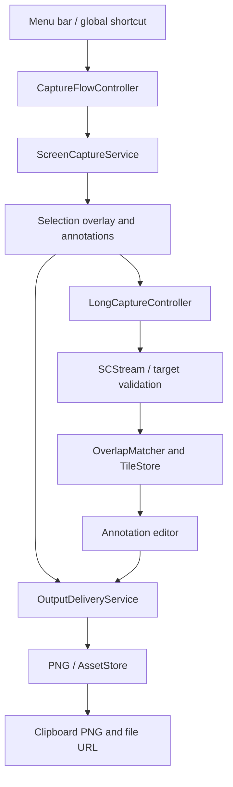

# 架构概览 / Architecture

应用为一个本地 macOS 进程：AppKit 承载菜单、浮层和编辑器，SwiftUI 承载设置与权限帮助。当前没有后端、数据库、任务队列或第三方运行时。

| 目录 / Directory | 职责 / Responsibility |
|---|---|
| [App](../LightCapture/App) | 生命周期、单实例、菜单、Carbon 热键、设置与权限帮助 |
| [Session](../LightCapture/Session) | 单会话、ID/generation、焦点、普通与长图流程 |
| [Capture](../LightCapture/Capture) | ScreenCaptureKit、显示器坐标、自动滚动目标、控制面板、权限检查 |
| [Overlay](../LightCapture/Overlay) | 框选、窗口选择、选区内标注和工具栏定位 |
| [Annotation](../LightCapture/Annotation) | 标注模型、历史命令、画布、共享工具样式、PNG 渲染前的图像合成 |
| [Stitching](../LightCapture/Stitching) | 像素对齐、唯一性/可靠性检查、增量图块与上限 |
| [Output](../LightCapture/Output) | PNG 编码、默认命名、暂存资产、剪贴板与另存 |
| [Localization](../LightCapture/Localization) | 语言清单、偏好、生效协调、线程安全上下文和文案入口 |

## 需要保持的边界

UI 与会话状态由 MainActor 管理。异步工作回到 UI 前核对会话 ID 与 generation，旧回调不得发布或覆盖新的会话。结束采集与发布截图分开：长图结束后仍需在编辑器完成。

普通截图先在内存中冻结显示器画面，再按选区/窗口选择裁剪。长图按区域接收画面并写入工作图块；帧交付有界，不为每帧无界排队。拼接不可靠时保留已确认内容，暂停或转入部分结果。

只有最终输出路径编码/保存并发布剪贴板。一个项目同时提供 PNG 数据、文件 URL 与私有资产 ID。`AssetStore` 管理文件生命周期；不把用户另存目录纳入回收。

语言在活动会话中冻结有效值，结束后才应用等待中的选择；后台文案读取受锁保护的不可变上下文，不跨线程操作 UI。用户标注文本不参与翻译。

具体实现以源码为准。编号设计书记录的是各次设计基线和决策，不意味着每个历史行号或所有候选技术都仍适用于当前代码。

## English summary

This is one native, local macOS process. AppKit owns the capture overlay/editor and SwiftUI owns settings/help. `CaptureFlowController` coordinates one active session; IDs and generations reject stale asynchronous work. Capture, editing, and publishing are separate stages.

Regular captures freeze display images for selection before cropping. Scrolling uses a bounded frame path, pixel matching, and temporary tiles. Uncertain stitching remains partial rather than silently successful. Output encodes PNG and publishes one clipboard item with image data, a file URL, and an owned asset ID. Only owned temporary assets are eligible for cleanup.

Localization defers effective-language changes during capture/editing and exposes thread-safe value snapshots to background code. See [Privacy](../PRIVACY.md), [Localization](LOCALIZATION.md), and the [development guide](DEVELOPMENT.md) before changing these boundaries.
