# OpenLightCapture 操作手册

[项目首页](../README.md) · [简版使用指南](USER_GUIDE.md) · [文档导航](README.md)

本手册适用于 OpenLightCapture 1.1.0，面向 macOS 13（Ventura）及以上版本，按简体中文界面说明。系统弹窗的名称和外观可能随 macOS 版本不同而变化。

应用包名为 `OpenLightCapture.app`。配图用于说明基本操作，部分示例界面与当前版本外观可能不同；应用名称和权限状态请以实际显示为准。

第一次使用请先看[权限准备](#permissions)。录屏请跳到 [GIF 动态截图](#gif)或[无声视频录屏](#video)，给截图加水印请看[文字水印模板](#watermark)。

## 目录

- [1. 快速完成第一张截图](#quick-start)
- [2. 第一次打开与权限准备](#permissions)
- [3. 区域截图与窗口截图](#capture)
- [4. 使用标注工具](#annotation)
- [5. 添加、移动和修改文字](#text)
- [6. 复制、粘贴与保存 PNG](#output)
- [7. 手动与自动长截图](#long-capture)
- [8. 设置语言、快捷键与启动方式](#settings)
- [9. 常用快捷键](#shortcuts)
- [10. 常见问题](#troubleshooting)
- [11. 使用边界与卸载](#limits)
- [12. GIF 动态截图](#gif)
- [13. 无声视频录屏](#video)
- [14. 文字水印模板](#watermark)

## 1. 快速完成第一张截图

权限已就绪时，按下面五步操作：

1. 打开 OpenLightCapture，点击菜单栏中的取景框图标，选择“截图”，或按默认快捷键 `⇧⌘A`。
2. 在屏幕上按住鼠标左键并拖动，框选要截取的范围。
3. 需要标注时，在选区工具栏中选择矩形、箭头、文字等工具。
4. 点击工具栏最右侧的“✓”（完成并复制）。没有处于文字输入状态时，也可按 `Enter` 或 `⌘C`。
5. 切换到支持图片的应用，按 `⌘V`；要得到 PNG 文件，打开 Finder 中可写的文件夹，再按 `⌘V`。

**完成标志：** 截图浮层关闭，目标应用出现图片，或 Finder 中出现 PNG 文件。如果只是完成了框选，图片还没有复制。

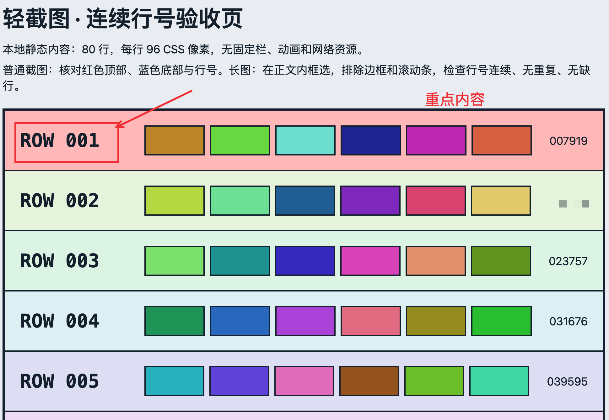

图 S01：完成后的截图示例。矩形、箭头、文字和马赛克会一起出现在最终图片中，选区边框与工具栏不会写入图片。

## 2. 第一次打开与权限准备

### 2.1 打开应用

打开 `OpenLightCapture.app`。OpenLightCapture 默认常驻菜单栏，不显示 Dock 图标；没有弹出主窗口属于正常情况。

通过 Homebrew 安装时，应用通常位于 `/Applications/OpenLightCapture.app`。建议从固定位置启动并授权，避免将另一个位置的副本加入系统权限。安装命令见[项目首页](../README.md#获取与构建)。

v1.1.0 的发行包采用 ad hoc 签名，尚未完成 Apple 公证。macOS 可能在首次启动时显示“未打开 OpenLightCapture”。核对官方 Release 和 SHA-256 后，若你决定继续，可以在“系统设置 → 隐私与安全 → 安全性”找到 OpenLightCapture，点击“仍要打开”并按提示确认。这个操作只处理应用的启动许可。录屏与自动滚动权限仍按下文分别开启。

### 2.2 按使用方式准备权限

| 要做的事      | 屏幕录制 | 控制权限 |
| --------- | ---- | ---- |
| 普通区域或窗口截图 | 需要   | 不需要  |
| GIF 录制 | 需要   | 不需要  |
| 无声视频录屏 | 需要   | 不需要  |
| 手动长截图     | 需要   | 不需要  |
| 自动长截图     | 需要   | 需要   |

控制权限在不同 macOS 版本中可能显示为“辅助功能”或“设备控制和数据访问”。OpenLightCapture 不需要麦克风、摄像头或全盘访问权限。

**开启屏幕录制：**

1. 首次发起截图、GIF 或视频录制且未授权时，先显示 macOS 的锁头授权对话框。选择“打开系统设置”后进入“录屏与系统录音”；选择“拒绝”则结束本次截图，不会自动打开设置。
2. 在系统设置中，找到当前使用的 OpenLightCapture 应用，手动开启右侧开关。
3. 开启后按系统提示选择“退出并重新打开”，再发起新的截图。若选择“以后”，请稍后自行退出并重新打开应用。

截图授权的设置跳转和重启提示由 macOS 管理，应用不会额外弹出重启提醒。若未出现系统授权对话框，也可从菜单栏打开“权限与帮助…”，点击“打开录屏权限设置”。

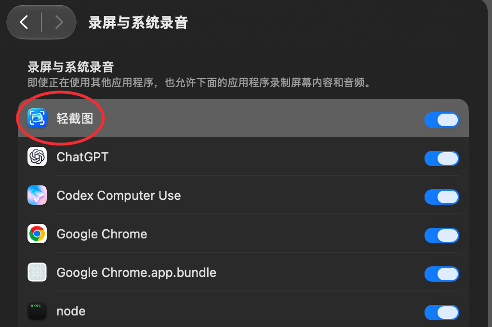

图 P01：在系统的“录屏与系统录音”设置中，找到 OpenLightCapture 并开启右侧开关。

**仅在需要自动滚动时开启控制权限：**

1. 选择自动滚动后，若没有控制权限，先显示 macOS 系统授权对话框。选择“打开系统设置”才进入控制权限页面；选择“拒绝”不会自动打开设置。也可从“权限与帮助…”点击“打开控制权限设置”。
2. 在系统对应的控制权限页面中允许 OpenLightCapture。
3. 开启后，OpenLightCapture 会自动提示“立即重启 / 稍后”，无需先返回应用；重启后新建一次长截图。

通过自动模式申请控制权限后，应用会持续检测授权状态：开启开关后，即使仍停留在系统设置，也会显示重启提醒；仅打开设置、拒绝授权或未开启开关就返回时不提示。授权检测与旧进程的事件投递能力分开，避免开关已开启、但自动滚动仍需重启时漏掉提醒。选择“立即重启”会结束当前截图，并在旧进程退出后重新打开当前路径的应用；重新打开后，请新建截图。选择“稍后”会保留当前面板，同一次授权不会反复弹窗；普通截图或手动长图仍可使用。

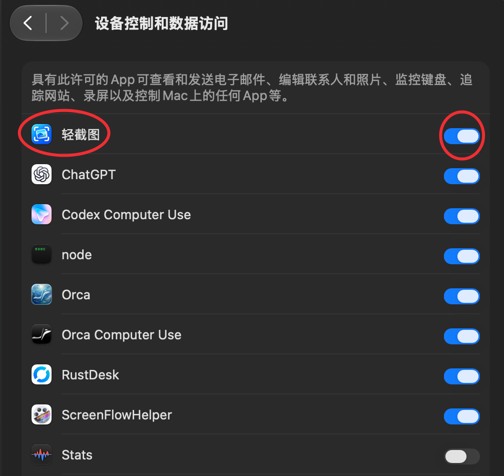

图 P02：自动长截图所需的控制权限。示例系统显示为“设备控制和数据访问”，开启 OpenLightCapture 对应的开关。

**检查是否生效：** 打开“权限与帮助…”，点击“刷新权限状态”。若系统开关已开启但应用仍显示“未生效”，先重启应用，再确认授权的是当前使用路径下的 app；“在 Finder 中显示本应用”可帮助定位。

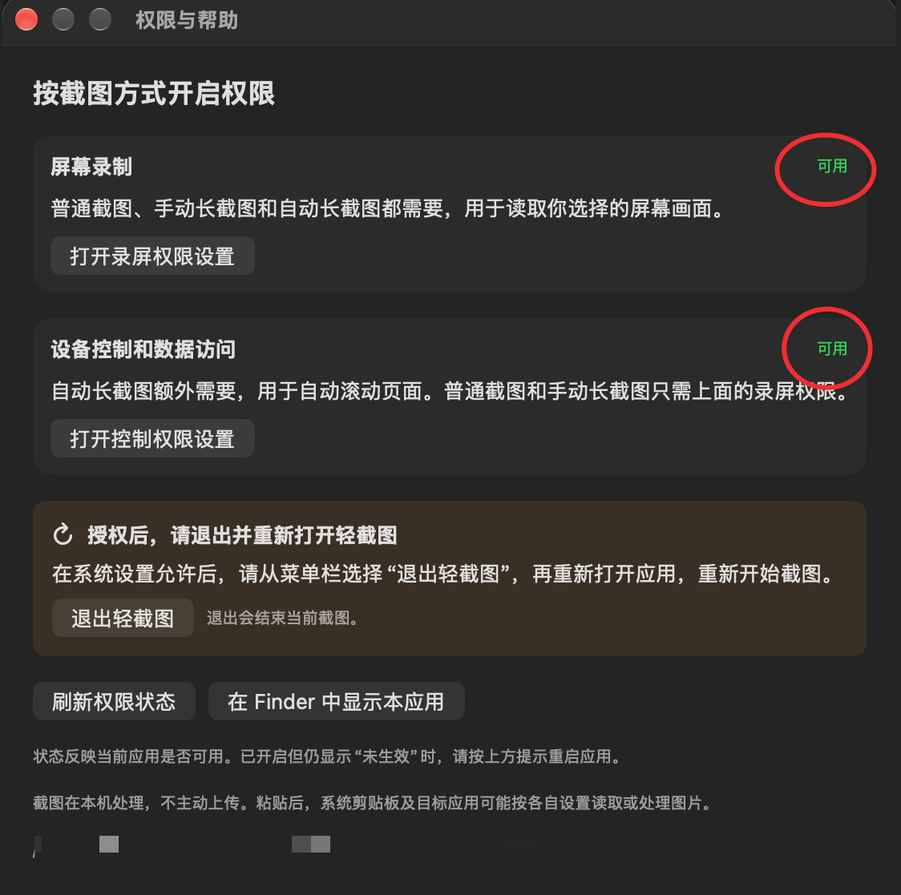

图 P03：重启应用后，在“权限与帮助”中确认两项权限显示“可用”。

普通截图、手动长图、GIF 和无声视频只需要屏幕录制权限。控制权限用于自动长图。

## 3. 区域截图与窗口截图

### 3.1 框选区域

1. 把要截图的内容放到前台，关闭会遮住内容的弹窗。
2. 从菜单栏选择“截图”，或按当前设置的截图快捷键。
3. 按住鼠标左键拖动，松开后生成选区。尺寸标记中的 `px` 表示输出像素，Retina 屏幕上可能大于你看到的界面尺寸。
4. 要调整范围，先点工具栏最左侧的“调整选区”，再拖动选区内部移动，或拖动边缘与角上的控制点改变大小。在选区外拖动可重新框选。
5. 范围正确后，直接标注或完成并复制。

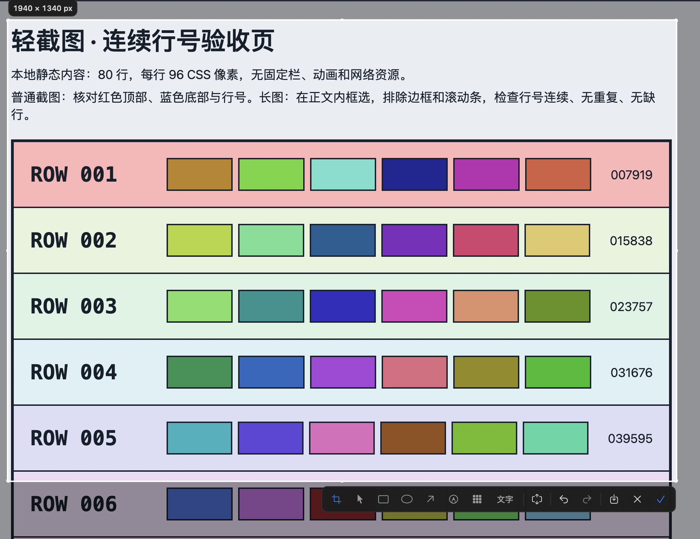

图 S02：选区尺寸显示在左上方，操作工具栏显示在选区下方。示例选区为 1940 × 1340 px；工具栏也可能根据屏幕空间移到上方。

### 3.2 选择整个窗口

1. 发起截图后按 `Space`，切换到窗口选择模式。
2. 将鼠标移到目标窗口，单击选择窗口范围。
3. 检查选区，再标注、保存或完成并复制。

将指针移到桌面时可选整块显示器。将指针移到菜单栏或 Dock 所在边缘时，可选排除该栏的工作区。再次按 `Space` 可回到区域选择。切换模式会清除当前选区，建议先确定截图方式，再开始标注。

### 3.3 取消本次截图

点击工具栏“×”（取消），或在没有处于文字输入状态时按 `Esc`。当前截图与标注不作为新结果发布。重新发起截图即可再次选择范围。

## 4. 使用标注工具

普通截图在选区内直接编辑；长截图在结束采集后的“截图编辑”窗口中编辑。两处使用相同的标注工具和样式选择方式。

| 工具   | 操作方法                        | 可调整的样式            |
| ---- | --------------------------- | ----------------- |
| 调整选区 | 普通截图中移动或缩放选区；长图编辑器中拖动框出裁剪范围 | 无                 |
| 选择标注 | 单击已有标注，再拖动到合适位置             | 无                 |
| 矩形   | 在要强调的内容周围按住并拖动              | 粗细、颜色             |
| 椭圆   | 拖动圈出重点                      | 粗细、颜色             |
| 箭头   | 从起点拖向要指示的位置                 | 粗细、颜色             |
| 画笔   | 按住鼠标自由绘制                    | 粗细、颜色             |
| 马赛克  | 拖动框出要模糊的区域                  | 颗粒：小、中、大          |
| 文字   | 点击选区输入说明，按回车确认              | 字号：14、18、24、32；颜色 |

选择形状、画笔、马赛克或文字后，工具栏附近会出现相应的样式条。形状与画笔有“细 / 中 / 粗”三档；颜色有红、橙、黄、绿、蓝、黑、白。

建议先选工具和样式，再绘制标注。矩形、椭圆、箭头、画笔、文字和马赛克都可以直接单击选中并拖动，无需切换当前绘制工具；选中时显示蓝色虚线框，重叠时优先选中最上层标注。也可用“选择标注”工具选中一项，按 `Delete` 删除。若要从已有标注上开始绘制新标注，按住 `Option` 再拖动。“调整选区”仍用于移动、缩放或裁剪截图范围。

需要撤回时点“撤销”，或按 `⌘Z`；误撤回可点“重做”，或按 `⇧⌘Z`。一次标注拖动对应一步撤销/重做，普通截图和长图编辑器操作相同。撤销/重做作用于当前截图会话。

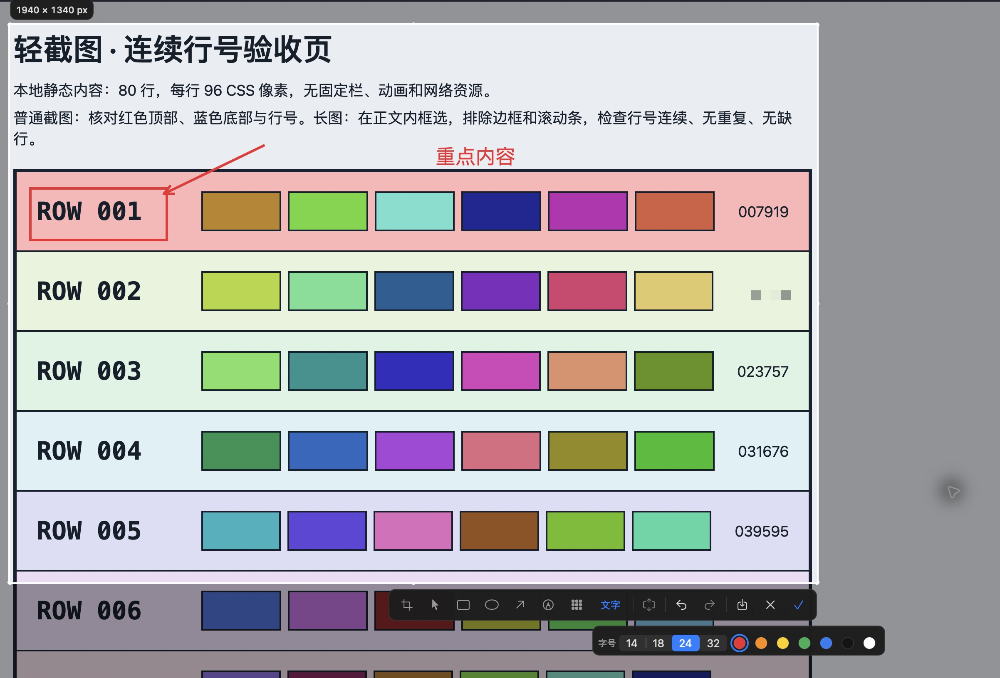

图 S03：第一行用矩形和箭头强调，第二行的合成编号覆盖马赛克，空白处加入文字。下方样式条随当前工具切换。

鼠标停在工具按钮上可查看名称。最右侧的保存、取消和完成按钮分别对应“保存到本地”“取消”“完成并复制”。

**长图顺序提醒：** 要做长截图，请先开始采集，再添加标注。普通选区中已有标注时，长截图按钮会变灰；可撤销全部标注后再开始长图。

## 5. 添加、移动和修改文字

1. 点击“文字”，在样式条中选择字号和颜色。
2. 在选区中单击需要说明的位置，输入文字。
3. 按 `Enter` 确认文字。使用中文输入法时，先完成候选词确认，再结束文字输入。
4. 按住已确认的文字并拖动，可调整位置；双击文字可再次编辑。
5. 完成文字输入后，点击“✓”或按 `⌘C`，完成整张截图。

**回车的含义取决于当前状态：** 正在输入文字时，它先确认文字；文字输入已经结束时，才用于完成截图。文字输入中的 `Esc` 用于取消本次文字编辑。

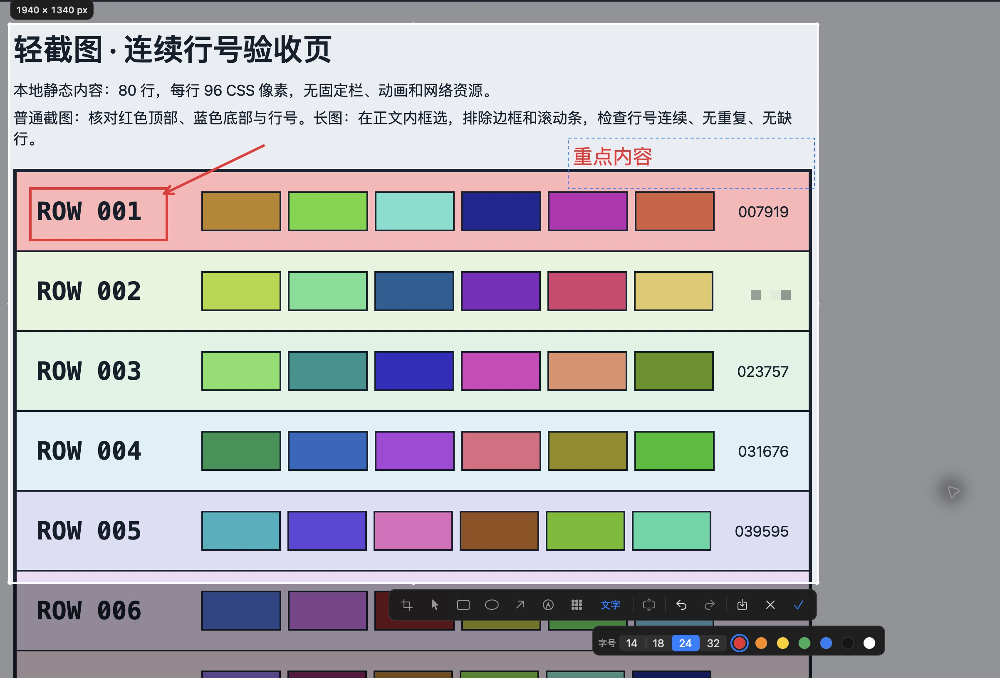

图 S04：确认后的“重点内容”已拖到右侧，蓝色虚线表示选中的文字标注；下方可见字号和颜色选项。

## 6. 复制、粘贴与保存 PNG

### 6.1 粘贴为图片

1. 完成截图标注，点击“完成并复制”，或在结束文字输入后按 `Enter` / `⌘C`。
2. 切换到支持图片粘贴的编辑区域，例如富文本编辑器或应用的图片输入区。
3. 点击输入位置，按 `⌘V`，确认出现的是图片。

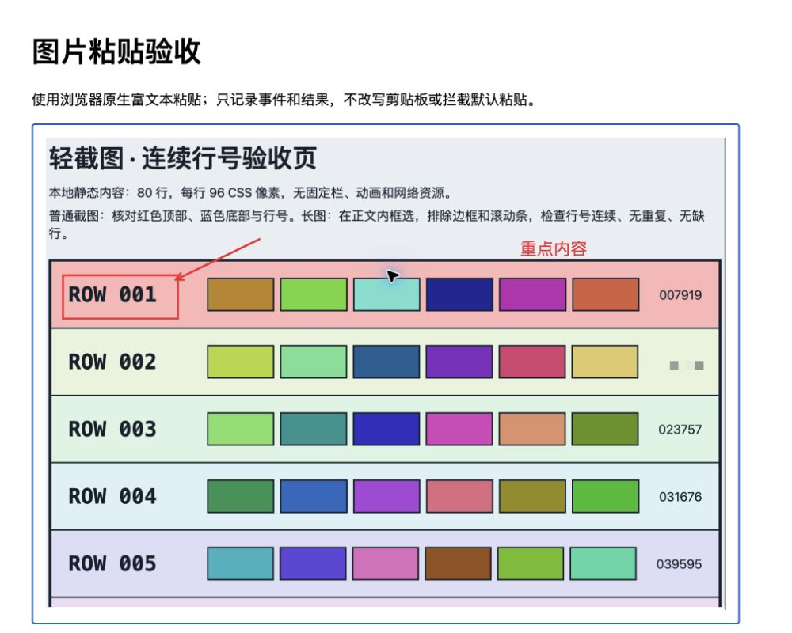

图 S05：在支持图片的输入区按 `⌘V`，图片直接插入正文。此处使用本地富文本演示页，不会上传图片。

纯文本编辑器可能不接收图片，接收应用也可能选择剪贴板中的文件表示。若没有出现图片，换到明确支持图片的输入区，或先保存 PNG 再插入。

### 6.2 在 Finder 中粘贴为文件

1. 完成并复制截图。
2. 打开 Finder，进入有写入权限的目标文件夹。
3. 按 `⌘V`。Finder 会生成 PNG 文件，默认文件名类似 `截图 2026-10-26 17.30.00.png`。
4. 选中文件按空格预览，确认内容正确。

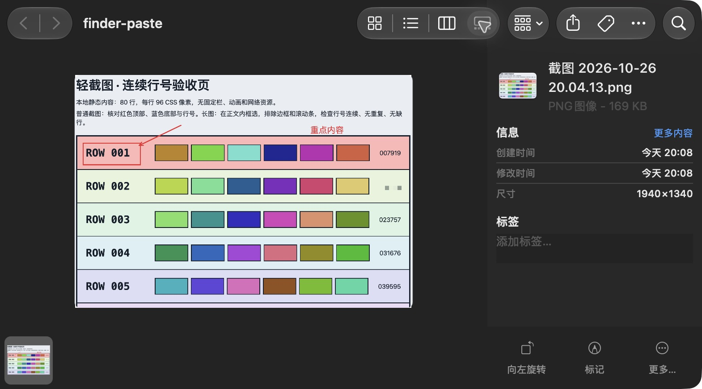

图 S06：Finder 的演示文件夹中出现 PNG；右侧显示文件名、格式与尺寸。图中 1940 × 1340 的文件与保存、图片粘贴的结果一致。

### 6.3 指定文件名和目录保存

1. 在截图选区或长图编辑器中，点击“保存到本地”（向下箭头按钮），或按 `⌘S`。
2. 在保存对话框中选择目录、修改文件名，点击“保存”（部分系统界面可能显示“存储”）。输出格式为 PNG。
3. 正常保存成功后，应用也会复制该截图，可以继续去目标应用按 `⌘V`。

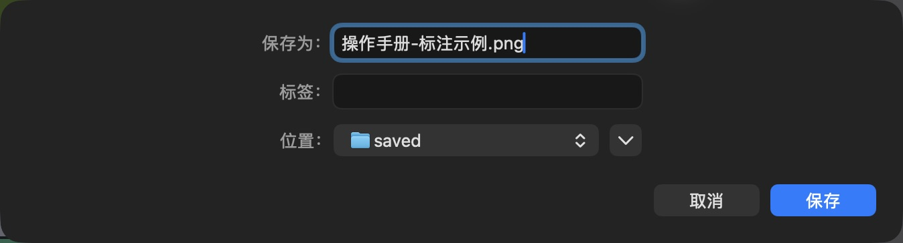

图 S07：示例保存为“操作手册-标注示例.png”。点击位置旁的展开按钮，可以查看更多目录选项。

取消保存对话框会回到当前截图，可继续编辑或改用“完成并复制”。若提示“文件已保存，复制失败”，先到所选目录确认 PNG；该提示表示保存已成功，剪贴板发布需要重试。

## 7. 手动与自动长截图

### 7.1 准备滚动内容

先把网页或长文档滚到希望开始的位置，等图片、字体和正文加载稳定。

1. 从菜单栏选择“长截图…”，屏幕提示“长截图 · 框选滚动区域”。拖动框选滚动正文，松开鼠标后直接进入手动/自动滚动面板；也可先从普通“截图”框选，再点工具栏中的长截图按钮。
2. 选区放在同一个窗口内，避开固定标题、底栏、悬浮按钮、滚动条和动态区域。内嵌列表应框选在该列表的滚动区域中。
3. 面板出现后，选择“手动滚动”或“自动滚动…”。

框选后随时按 `Esc` 可取消本次长截图，焦点在控制面板或目标页面均有效；取消会关闭面板、清除遮罩并释放截图会话。此快捷键仅在长图会话期间启用。

选区应包含足够多、彼此不同的正文，以便识别相邻画面的重叠位置。只有大块留白或重复条纹时，拼接可能无法继续。

选区确认后，截图区域保持正常亮度，选区外持续变暗；手动或自动滚动时提示不会消失。遮罩不拦截鼠标和滚轮，也不会进入最终长图。暂停期间保留区域提示；结束、取消、采集失败或目标窗口失效后恢复亮度。申请自动滚动控制权限时会暂时移除遮罩，方便操作系统设置。

### 7.2 手动长截图

1. 点击“手动滚动”。
2. 在原窗口的选区内小幅、连续向下滚动。每次保留足够的上一屏内容，避免一次跳过整屏。
3. 观察面板中的“已确认 … px”。出现“正在等待画面稳定并确认拼接位置”时先暂缓滚动。
4. 需要暂时停止时点击“暂停”，准备好后点击“继续”。
5. 采集到所需位置后点击“结束并预览”。

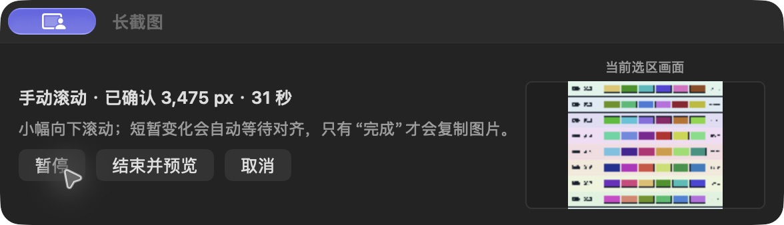

图 S08：手动采集示例从 1,555 px 增加到 3,475 px；需要检查图片时点“结束并预览”。右侧只显示当前选区画面。

### 7.3 自动长截图

1. 确认控制权限已经生效，点击“自动滚动…”。
2. 应用锁定所选目标窗口并自动向下滚动。鼠标可以移出选区。
3. 保持原窗口与页面不变，避免切换应用、移动窗口或调整显示器配置。
4. 需要停一下时点“暂停”，之后可“继续”；需要自行控制滚动时点“转为手动”。
5. 采集到所需内容后点击“结束并预览”。

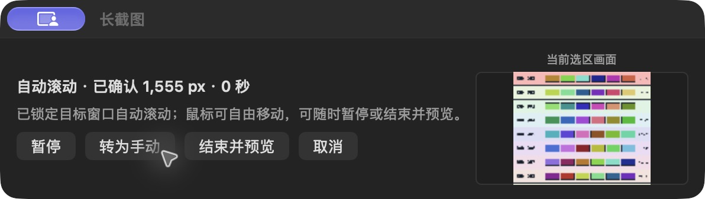

图 S09：自动模式启动后的操作面板，可暂停、转为手动或结束并预览。启动成功后仍需观察已确认高度是否增加；遇到部分结果时按下文处理。

没有控制权限时，可直接选择手动滚动。自动模式的权限说明与设置截图见 [第 2 节](#permissions)。

### 7.4 检查长图并输出

1. 结束采集后进入“截图编辑”窗口。
2. 用“适应窗口”查看整体，用“适应宽度”或 `100%` 检查正文，滚动查看接缝和底部。
3. 确认有无重复、缺段，首尾是否覆盖所需内容，再按需裁剪、标注或加[文字水印](#watermark)。
4. 点击“完成并复制”，或用“保存到本地”输出 PNG。

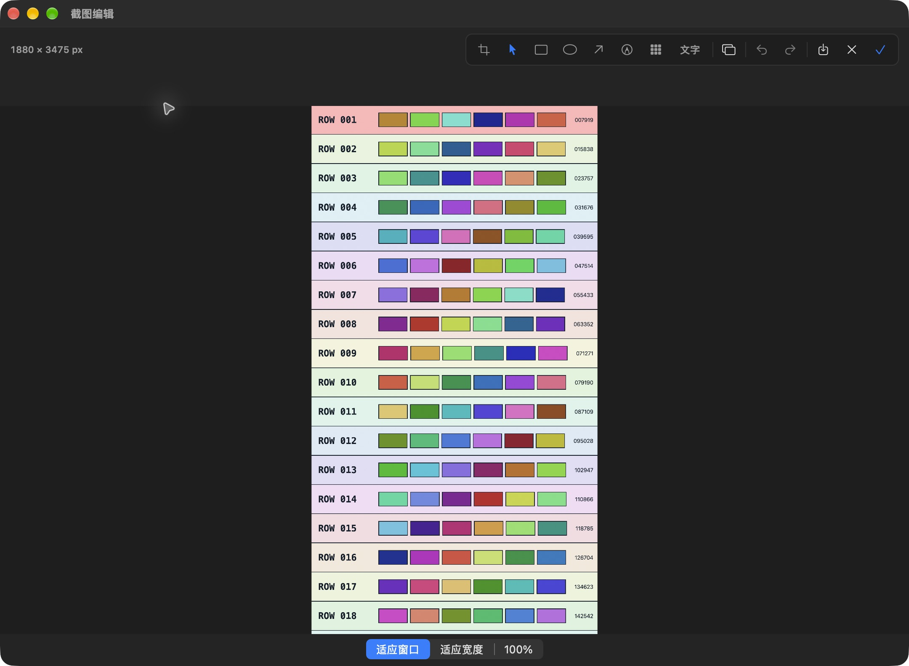

图 S10：手动采集后的长图编辑器。顶部是统一标注与输出工具，底部可切换缩放方式。此例主动结束于所需片段，不是整张 80 行示例页面。

**“结束并预览”只结束采集，不会立即复制图片。** 进入编辑器后还要完成或保存一次。

面板右侧的“当前选区画面”是采集区域缩略图，不是整张长图的实时总览。长图编辑器里的“换图…”可重新选择普通截图或开始长截图；切换来源会提示丢弃当前标注和裁剪，选“留在编辑”可保留当前内容。

### 7.5 遇到暂停或部分结果

| 提示或现象         | 建议操作                        |
| ------------- | --------------------------- |
| 正在等待画面稳定      | 暂缓滚动，等动态内容稳定后再观察已确认高度       |
| 画面变化过大、重叠不足   | 减慢滚动，保留更多上一屏内容；必要时重选区域      |
| 固定栏或重复内容影响对齐  | 缩小选区，排除固定区域，保留更多不同的正文       |
| 原目标切换、窗口关闭/移动 | 回到目标页面，重新发起并框选              |
| 未检测到更多内容      | 自行检查所需末尾是否已捕获；此提示不能保证到达页面底部 |
| 部分结果          | 选择“使用已捕获部分”进入编辑器检查，或取消后重来   |
| 无可靠画面可预览      | 取消本次采集，稳定页面后重新开始            |

部分结果只包含已经可靠确认的内容。使用前检查首尾范围，不要把部分结果当作完整页面。

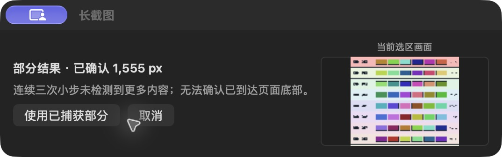

图 S11：本次自动模式演示出现“连续三次小步未检测到更多内容；无法确认已到达页面底部”。点击“使用已捕获部分”后，仍需在编辑器中完成并复制；需要后续正文时，取消并改用手动模式重新采集。

## 8. 设置语言、快捷键与启动方式

从菜单栏打开“设置…”。

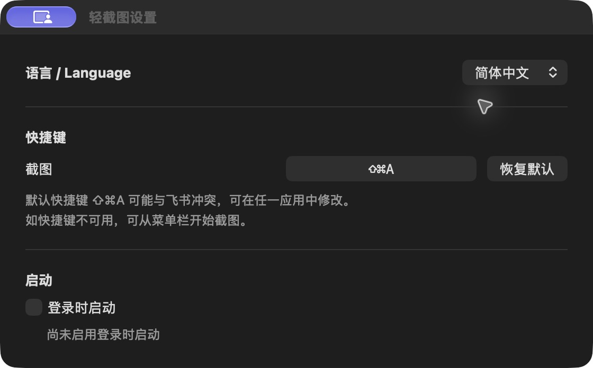

图 S12：设置中的语言、截图快捷键与登录时启动。示例使用简体中文，未启用登录时启动。

### 8.1 切换界面语言

在“语言 / Language”中选择“跟随系统”“简体中文”或“English”。选择会自动保存。

- 空闲时立即生效；正在截图或编辑时，结束或取消当前截图后生效。
- 跟随系统且没有匹配语言时，使用英文。
- 新文件名的默认前缀会随语言使用“截图”或“Screenshot”；已存在的文件、手动文件名和自己输入的文字标注不变。
- 系统对话框可能继续使用 macOS 的语言。

### 8.2 修改截图快捷键

1. 点击“截图”右侧显示当前组合键的按钮。
2. 出现“按下组合键，Esc 取消”后，按下想使用的新组合键。至少包含一个修饰键，如 `⌘`、`⇧`、`⌥` 或 `⌃`。
3. 看到“已设置：…”后，关闭设置窗口，在其他应用中试用。

录入中按 `Esc` 取消，保留原快捷键。点击“恢复默认”恢复 `⇧⌘A`。录入期间语言选择暂不可用，先完成或取消录入再切换语言。

默认组合可能与飞书冲突。如果快捷键没有反应，先使用菜单栏“截图”确认功能，再修改冲突组合。

### 8.3 登录时启动

按需勾选“登录时启动”。如果界面提示系统需要允许登录项，按系统提示完成；取消勾选可关闭该行为。此设置只控制登录后是否启动应用。

## 9. 常用快捷键

`⌘` = Command，`⇧` = Shift，`⌥` = Option，`⌃` = Control。

| 场景                 | 快捷键            | 效果               |
| ------------------ | -------------- | ---------------- |
| 全局                 | `⇧⌘A`（默认，可修改）  | 开始截图             |
| 选择范围时              | `Space`        | 切换区域与窗口/整屏选择，清除当前选区 |
| 当前截图               | `⌘Z` / `⇧⌘Z`   | 撤销 / 重做          |
| 当前截图，未输入文字时        | `Enter` 或 `⌘C` | 完成并复制            |
| 正在输入文字             | `Enter`        | 确认当前文字           |
| 正在输入文字             | `Esc`          | 取消当前文字编辑         |
| 当前截图               | `⌘S`           | 打开 PNG 保存对话框     |
| 当前截图，未输入文字时        | `Esc`          | 取消本次截图           |
| 水印面板内             | `⌘Return`      | 应用本次水印            |
| 长图采集期间            | `Esc`          | 取消本次长图并移除遮罩       |
| 支持图片的目标应用 / Finder | `⌘V`           | 粘贴为图片或 PNG / GIF 文件 |

双击选区也可完成普通截图；为了避免与双击文字编辑混淆，建议优先使用“✓”按钮。

## 10. 常见问题

| 问题                | 排查方法                                                  |
| ----------------- | ----------------------------------------------------- |
| 打开后没有主窗口或 Dock 图标 | 在菜单栏找取景框图标，OpenLightCapture 默认常驻菜单栏                                 |
| 快捷键无反应            | 先点菜单栏“截图”；若可用，在设置中修改冲突快捷键                             |
| 已授权仍无法截图          | 退出重开；在“权限与帮助…”刷新状态并核对当前 app 路径，见 [权限准备](#permissions) |
| 长截图按钮变灰           | 当前选区已有标注；撤销标注后开始，或新建一次截图                              |
| 按回车只确认了文字         | 这是文字输入状态；结束输入后再点击“完成并复制”                              |
| 长图结束后粘贴仍是旧内容      | “结束并预览”后还要在编辑器中完成并复制                                  |
| 目标应用不出现图片         | 确认已完成复制、输入区支持图片；可保存 PNG 后插入                           |
| Finder 无法粘贴       | 确认当前文件夹可写，并重新完成一次截图后再粘贴；不要删除仍被剪贴板引用的本地 PNG            |
| 保存失败或空间不足         | 换到可写目录，检查磁盘空间；保留编辑画面，处理后重试                            |
| 录制按钮后直接倒计时        | 点击“取消”返回准备面板，在那里调整“显示鼠标”或重选区域 |
| GIF 粘贴后只显示静态图      | 目标应用可能只读取首帧，可保存 GIF 后以文件方式发送 |
| 保存视频后粘贴仍是旧内容     | MP4 保存到选定目录，剪贴板内容维持原样 |
| 自动滚动停止            | 查看面板原因；保持目标窗口稳定，必要时改手动或重新框选                           |
| 切换语言后部分按钮未改变      | 先结束当前截图或快捷键录入；系统按钮可能仍跟随系统语言                           |
| 锁屏、休眠或显示器变化后截图消失  | 当前会话可能被取消；回到稳定桌面后重新发起截图                               |

若 macOS 拦截下载包，先核对该版本的来源、签名与公证说明；也可按 [开发指南](DEVELOPMENT.md) 从源码构建。当前本地开发包采用 ad hoc 签名，不表示已公证。不要为打开应用而关闭系统安全机制。

反馈问题时，提供版本、macOS 版本、复现步骤和提示原文；分享示例前先移除私人信息。联系渠道见 [支持说明](../SUPPORT.md)。

## 11. 使用边界与卸载

### 11.1 当前长图边界

| 项目        | 当前范围                             |
| --------- | -------------------------------- |
| 最大高度      | 50,000 原生像素                      |
| 最大像素总量    | 60 百万像素；宽图可能先达到此上限               |
| 活动采集时间    | 180 秒，暂停时间不计入                    |
| 滚动方向      | 向下，不支持横向或双向长图                    |
| 容易影响拼接的内容 | 固定栏、大面积动画、虚拟列表、重复纹理、横向漂移、反向或过快滚动 |

达到上限或无法可靠确认后续内容时，可能暂停或仅保留部分结果。应用提供短时 GIF 和无声 MP4 区域录屏，不提供 WebM、音频、OCR、云同步、截图历史库或整张长图实时总览。Intel 与较早 macOS 的实机覆盖仍不完整。

### 11.2 本地文件与隐私

截图、水印和录屏在本机处理。为支持 Finder 文件粘贴，应用会暂存 PNG 或 GIF，长图和录制期间也会创建工作文件。OpenLightCapture 的默认数据目录为 `~/Library/Application Support/io.github.evilstar2016.openlightcapture/`。这不是面向用户的截图历史库。

剪贴板可能仍引用暂存的 PNG 或 GIF，删除文件后对应的 Finder 粘贴可能失效。另存的 PNG、GIF 和 MP4 位于你选择的目录。更多说明见 [隐私说明](../PRIVACY.md)。

### 11.3 卸载

1. 在设置中关闭“登录时启动”。
2. 从菜单栏选择“退出 OpenLightCapture”。
3. 使用 Homebrew 安装的版本可运行 `brew uninstall --cask evilstar2016/tap/openlightcapture`。手动安装的版本可在 Finder 中移除 `OpenLightCapture.app`。
4. 确认不再需要当前剪贴板的文件粘贴后，可自行删除上述应用数据目录；自己另存的图片需单独处理。

语言、快捷键和登录项意图保存在 macOS 用户偏好中。使用其他 Bundle ID 构建的应用，其偏好域与数据目录也会不同。

## 12. GIF 动态截图

### 12.1 选择区域并录制

1. 将要录制的内容放在前台。在菜单栏选择“录制 GIF”，再拖动框选。也可先发起普通截图，再点选区工具栏的“录制 GIF”。
2. 点选区上的“录制 GIF”后直接进入 3 秒倒计时。若普通截图选区已有标注或水印，OpenLightCapture 会先询问是否“清除并录制”。需要保留当前编辑时选“取消”。
3. 要在开始前调整设置，倒计时期间点“取消”，返回准备面板。在面板中检查输出尺寸，可调整“显示鼠标”或重新选择区域，再点“开始录制”。
4. 倒计时结束后，红点闪动，面板显示已录时间。操作目标应用，完成后点击“停止并预览”。要丢弃本次录制，点击“放弃”。录满 30 秒会自动停止并生成预览。

录制范围固定在屏幕上。移动目标窗口或让其他窗口、通知覆盖选区时，选区里可见的内容会随之录入。选区外的遮罩用于提示录制范围。

### 12.2 预览、保存与粘贴

1. 在“GIF 预览”检查画面、时长、尺寸和文件大小。可暂停循环预览，再继续播放。点击“重录”并确认后返回准备面板，可继续用原区域，或重新选择区域。
2. 点击“复制动图”可直接复制。需要保留文件时，点击“保存并复制”，选择文件名和保存目录。取消保存会返回预览。若保存成功但复制失败，可保留已保存文件，再重试复制。
3. 要粘贴为文件，在 Finder 打开可写目录后按 `⌘V`。接收应用可能显示动图、首帧或附件。需要确保对方收到 GIF 时，发送保存的 `.gif` 文件。

**完成标志**是在保存目录中看到可播放的 `.gif`，或在 Finder 中粘贴得到 GIF 文件。

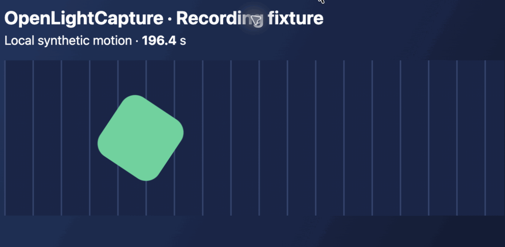

GIF 最高 10 fps，长边最多 1280 px，小选区按原尺寸输出。单文件上限 50 MiB。超限时可查看原始素材预览，再缩小选区或缩短录制时间。录制过程没有暂停和剪辑。更多说明见 [GIF 使用指南](USER_GUIDE.md#gif)。

## 13. 无声视频录屏

### 13.1 选择区域并录制

1. 从菜单栏选择“录制视频”，或在普通截图的选区工具栏中点“录制视频”。如果选区已有标注或水印，确认“清除并录制”后继续。
2. 框选后点击“录制视频”，等待 3 秒倒计时。如要关闭“显示鼠标”或重选区域，在倒计时中点“取消”，调整后点击“开始录制”。
3. 录制时保持目标内容在原区域内。点击“停止并预览”结束，或点“放弃”丢弃本次录制。录满 10 分钟会自动停止。

视频只录制画面。系统声音和麦克风声音均不写入文件。选区固定，覆盖选区的通知和窗口可能入镜。

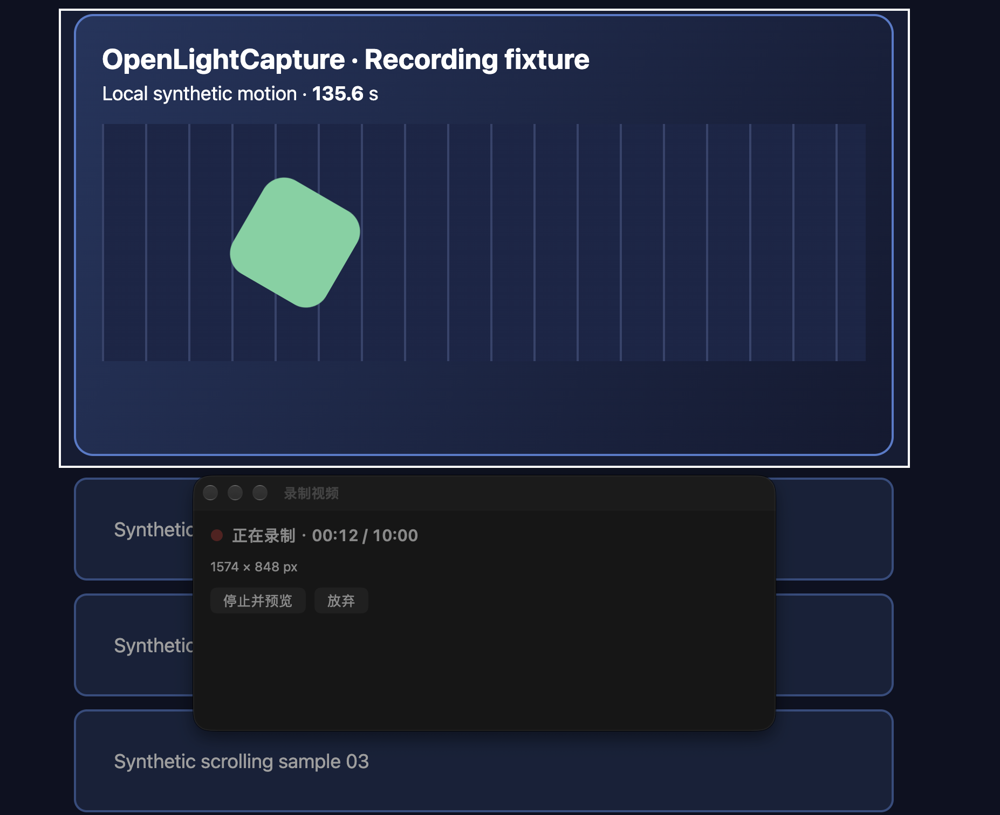

图 S13 的白框标出录制区域。下方的控制面板显示录制时长和输出尺寸，点击“停止并预览”结束录制。

### 13.2 播放、重录与保存

1. 在“视频预览”用播放器播放、暂停或拖动进度，检查开头和结尾。需要重新录制时点“重录”，确认后回到准备面板。
2. 点击“保存视频”，在保存对话框中选择目录和文件名。取消保存或保存失败时，预览仍可用于重试。保存成功后在目标目录打开 `.mp4` 检查结果。
3. 分享视频时，从保存目录选择文件。保存视频只写入选定路径，剪贴板内容维持原样。

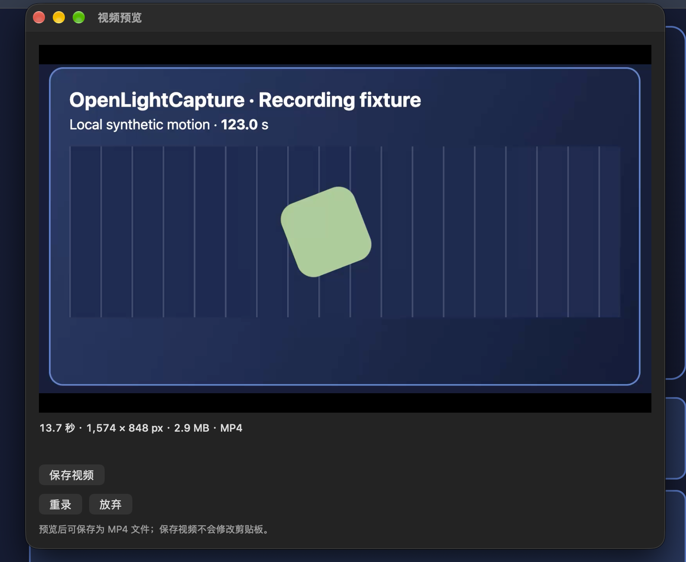

图 S14 显示录制结束后的画面、时长、尺寸和文件大小。点击“保存视频”选择保存位置。

**完成标志**是在保存目录中看到可播放的 `.mp4`。视频使用 H.264 编码，最高 30 fps，长边最多 1920 px，小选区不会放大，宽高向下取偶数。单文件上限 1 GiB。暂存视频会在放弃、重录、会话结束或下次启动时清理。更多说明见[视频录屏指南](USER_GUIDE.md#video)。

## 14. 文字水印模板

### 14.1 建立模板和默认水印

1. 从菜单栏进入“设置…”，在“水印模板”中点“管理模板…”。
2. 新建模板，或选中“角落参考”“居中提示”“平铺防转载”等内置模板后点“复制模板”。填写模板名称和水印文字，选择单点或平铺，再按需调整位置、字体大小、颜色、透明度、角度和间距。
3. 点击“保存模板”。回到设置后，可以从“默认水印”选择一个模板或“无水印”。修改默认项后，下一次发起截图时生效。

模板保存在本机。内置模板可复制后修改，模板正文最多 120 字符、3 行。

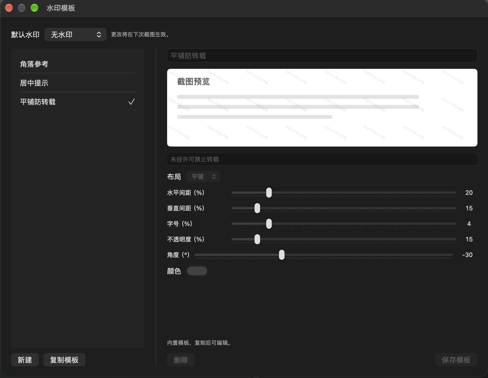

图 S15 展示内置的“平铺防转载”模板。要编辑它，先点击左下角的“复制模板”。

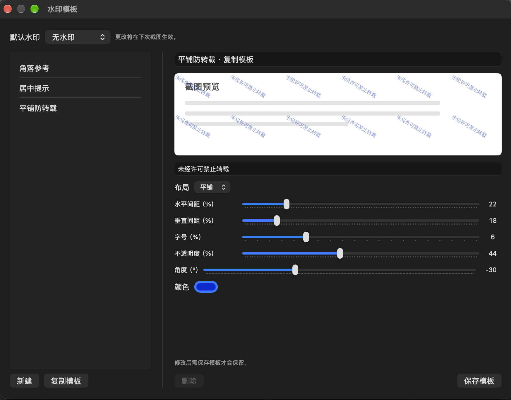

图 S16 展示复制模板后调整平铺间距、字号和颜色的效果。检查预览后，点击“保存模板”保留修改。

### 14.2 应用到本次截图或长图

1. 完成普通截图的框选，或结束长图采集进入编辑器，点击工具栏上的水滴图标“水印”。
2. 选择模板或“无水印”。可以只为本次截图修改文字和样式，面板内的示例会随草稿变化。
3. 点击“应用”或按 `⌘Return`，回到截图检查位置和可读性。点击“取消”或点面板外会丢弃未应用的草稿。已应用的修改可撤销或重做。
4. 确认最终裁剪范围后，按原有流程完成并复制或保存 PNG。长图的水印在拼接结束后编辑。临时调整保留在本次截图内，模板仍可供下次使用。

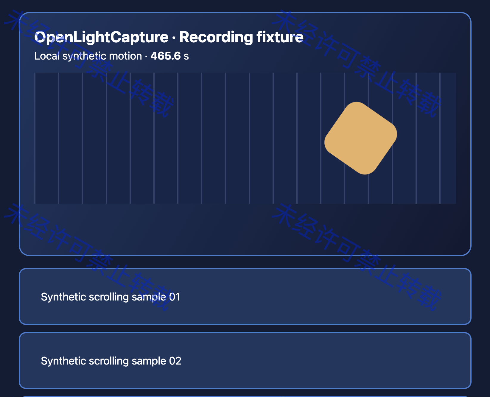

图 S17 是应用平铺模板后导出的 PNG，水印随截图保存。

水印用于普通截图和长图。录制 GIF 或 MP4 时只录所选屏幕区域。需要从含水印或标注的选区切换到录制，可在提示中选择“清除并录制”。
